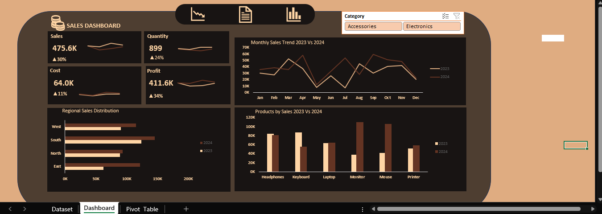
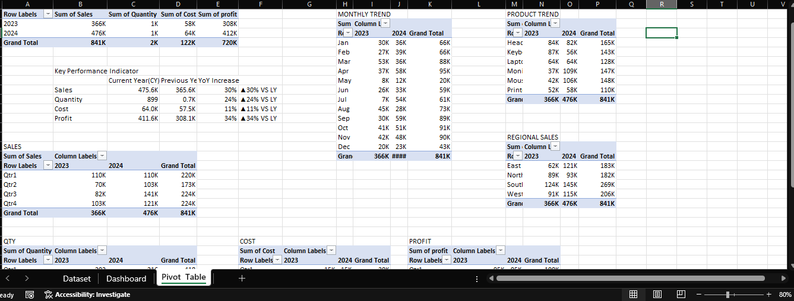

Excel Sales Analysis Dashboard

Project Overview

This project features an interactive Microsoft Excel dashboard designed to analyze sales performance over a two-year period (2023–2024). The dashboard provides a comprehensive view of Key Performance Indicators (KPIs), year-over-year (YoY) trends, regional distribution, and product performance, allowing business leaders to track growth and make data-driven decisions.

Business Problem

Tracking sales performance across multiple dimensions (time, region, and product) in raw spreadsheets can be overwhelming. Businesses need a centralized, dynamic view that instantly highlights what is working and what is falling behind. This dashboard solves that problem by transforming raw transactional data into a clean, interactive reporting tool with automated YoY comparisons.

Project Objectives

  To track high-level KPIs (Sales, Quantity, Cost, and Profit) and compare them against the previous year.
  To visualize monthly sales trends to identify seasonal peaks and dips.
  To analyze regional sales distribution across East, North, South, and West.
  To evaluate product performance across different categories.

Tools and Technologies Used

   Microsoft Excel: Data structuring, PivotTables, PivotCharts, Slicers, and dashboard design.
   Advanced Formulas: Used `GETPIVOTDATA`, custom YoY calculation formulas, and dynamic text functions for visual indicators (▲/▼).

Data Preparation and Analysis Process

   Data Structuring: Converted raw data into an official Excel Table to utilize structured references.
   Feature Engineering: Extracted Month and Year from the raw transaction dates using the `TEXT` function. Created a calculated Profit column (`Sales - Cost`).
   Pivot Table Modeling: Built separate PivotTables for KPIs, Monthly Trends, Product Sales, and Regional Sales to power the dashboard charts.
   Dynamic KPI Cards: Utilized `GETPIVOTDATA` to pull current and previous year values dynamically, and custom formulas to calculate YoY percentage changes.

Dashboard Features

    Interactive Slicers: Filter the entire dashboard by Product Category (Accessories vs. Electronics).
    KPI Cards: Highlight Total Sales, Quantity, Cost, and Profit, complete with sparklines and YoY growth indicators.
    Monthly Sales Trend: A line chart comparing 2023 and 2024 sales to spot seasonal trends.
    Product & Regional Analysis: Bar charts breaking down sales by product and region for both years.

Dashboard Preview

Full Dashboard View

Pivot Table Backend & KPIs

Key Insights & Findings

   Overall Growth: The business saw strong YoY growth in 2024, with Sales increasing by 30% and Profit increasing by 34%.
   Seasonal Trends: Sales peak consistently in the later months of the year (October to December), while May and June show noticeable dips.
   Regional Performance: The South region generated the highest sales across both years, while the **West** region had the lowest.
   Product Performance: Headphones and Keyboard are the top-selling products. However, there is a significant spike in Monitor sales in 2024 compared to 2023.

How to Access the Report

   Download the `Sales_analysis_dashboard.xlsx` file from this repository.
   Open it in Microsoft Excel (ensure you enable editing/content if prompted).
   Use the Category slicer on the top right to interact with the data and watch the charts and KPIs update dynamically.

Conclusion

This project demonstrates practical Excel skills for data analysis, including building dynamic models, writing complex lookup and date formulas, and designing a professional, interactive user interface.
